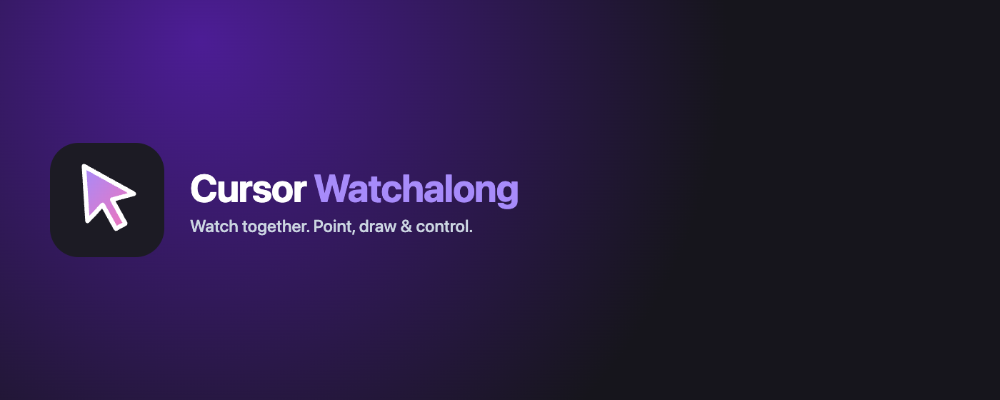
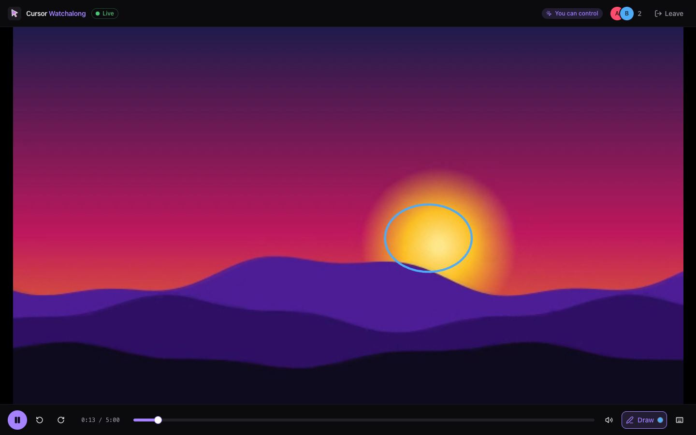
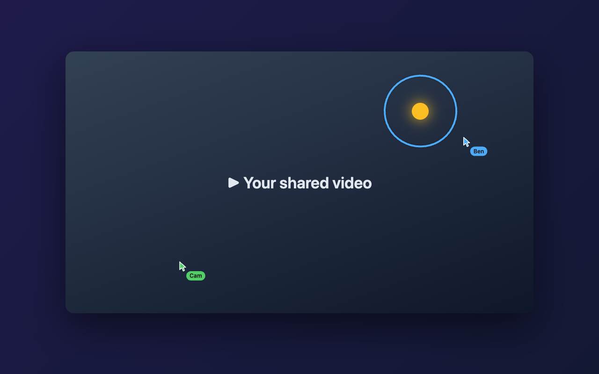
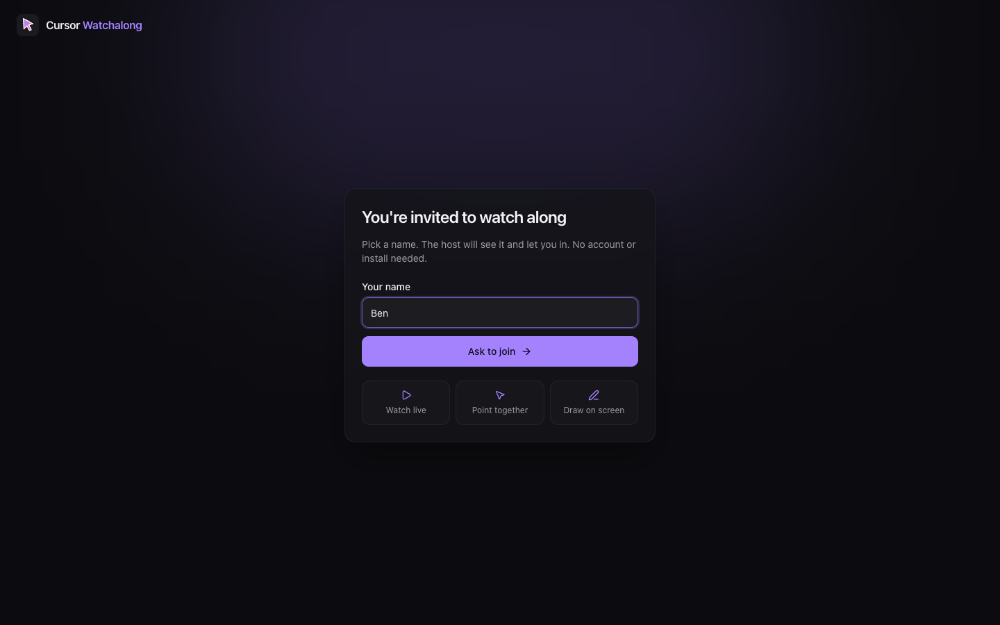
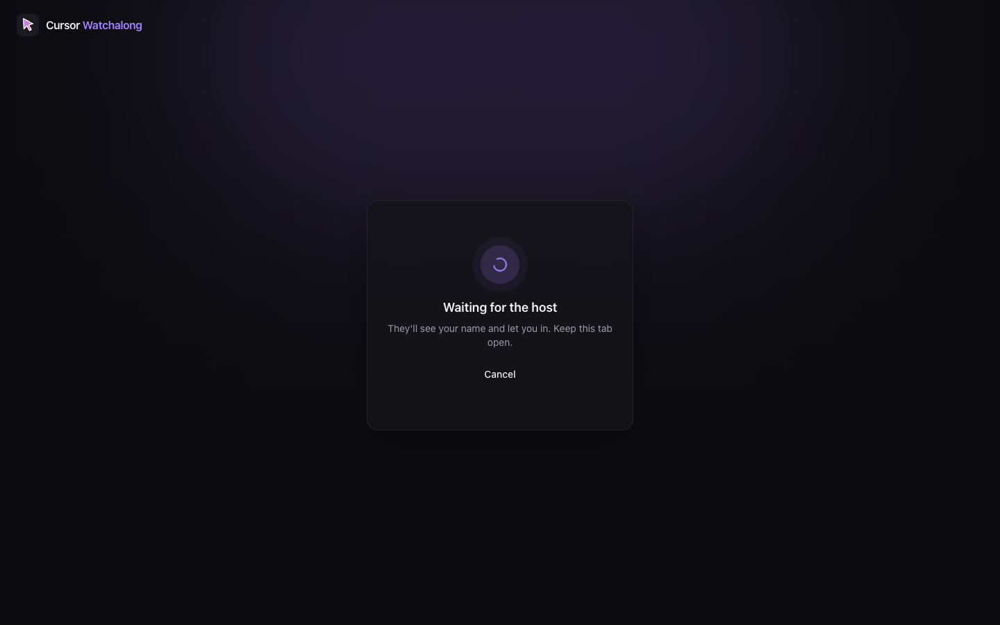
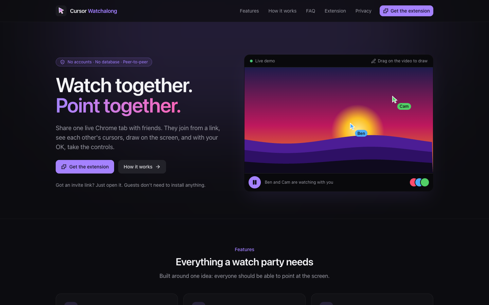
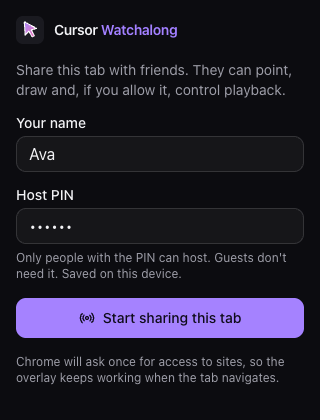
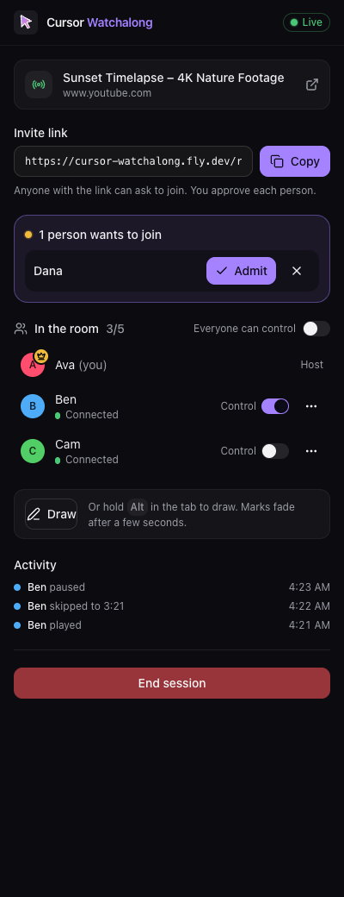
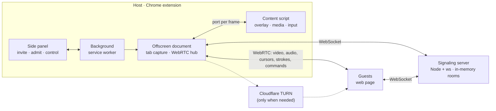

<div align="center">



<h1>Cursor Watchalong</h1>

<p><strong>Share a live Chrome tab with friends who can point, draw, and take the wheel.</strong><br />
Screen sharing where guests interact with the page instead of only watching it.</p>

<p>
  <a href="https://cursor-watchalong.fly.dev"></a>
  <a href="LICENSE"></a>
  
  
  
  
</p>

<p>
  <a href="#demo">Demo</a> ·
  <a href="#features">Features</a> ·
  <a href="#screenshots">Screenshots</a> ·
  <a href="#how-it-works">How it works</a> ·
  <a href="#getting-started">Getting started</a> ·
  <a href="#deployment">Deployment</a> ·
  <a href="#security--privacy">Security</a> ·
  <a href="docs/design.md">Design doc</a>
</p>

</div>

---

## Demo

<p align="center">
  <a href="docs/demo/cursor-watchalong-demo.mp4">
    
  </a>
  <br /><sub>24-second demo: join from a link, draw on the shared tab, take control. <a href="docs/demo/cursor-watchalong-demo.mp4">Watch the MP4</a>.</sub>
</p>

## Overview

A host shares one tab through the Chrome extension and sends an invite link. Friends join from a
regular web page with **no install and no account**. Everyone sees each other's named cursors and
can draw quick marks that fade after a few seconds. When the host allows it, guests can play,
pause, seek, click and scroll in the host's real tab.

It's built for watching videos together: spot a detail, pause, circle it, hit play.

- **No database.** Rooms live in memory on a small signaling server and disappear when they end.
- **Peer-to-peer.** Video, audio, cursors and drawings go directly between browsers over
  encrypted WebRTC, with a Cloudflare TURN relay for restrictive networks.
- **Host in control.** The host approves every guest, chooses who can control the tab, and can
  require a PIN to start sessions at all.

## Features

<table>
  <tr>
    <td width="50%" valign="top">
      <h4>📺 Live tab sharing</h4>
      The host's tab video and audio at up to 1080p30, with stereo audio and adaptive quality.
    </td>
    <td width="50%" valign="top">
      <h4>🔗 Invite links + approval</h4>
      Unguessable links (the secret never reaches server logs). Each guest waits until the host admits them.
    </td>
  </tr>
  <tr>
    <td valign="top">
      <h4>🖱️ Named cursors</h4>
      Every participant gets a color and a name tag, drawn right in the host's tab so everyone sees the same thing.
    </td>
    <td valign="top">
      <h4>✏️ Fading drawings</h4>
      Freehand marks in your color that fade about three seconds after you lift the pen. Press <kbd>D</kbd> or hold <kbd>Alt</kbd>.
    </td>
  </tr>
  <tr>
    <td valign="top">
      <h4>⏯️ Playback control</h4>
      Play, pause, seek and mute the page's video, with YouTube-style shortcuts (<kbd>Space</kbd>, <kbd>K</kbd>, <kbd>J</kbd>/<kbd>L</kbd>, arrows, <kbd>M</kbd>).
    </td>
    <td valign="top">
      <h4>👆 Clicks and scrolling</h4>
      Guests with control click, double-click and scroll in the real page, including inside embedded players.
    </td>
  </tr>
  <tr>
    <td valign="top">
      <h4>🛡️ Permissions</h4>
      Guests start with point and draw only. The host grants control per guest or to everyone, and can revoke it instantly.
    </td>
    <td valign="top">
      <h4>🔄 Resilient</h4>
      Survives dropped connections: a 30-second host grace period, silent guest rejoin, and ICE restarts.
    </td>
  </tr>
</table>

## Screenshots

<table>
  <tr>
    <td colspan="2" align="center">
      
      <br /><sub><b>Guest view:</b> the host's live tab, a guest's circle in their color, playback controls and the Draw toggle.</sub>
    </td>
  </tr>
  <tr>
    <td width="50%" align="center">
      
      <br /><sub><b>In the shared tab:</b> named cursors and a fading mark, baked into the stream.</sub>
    </td>
    <td width="50%" align="center">
      
      <br /><sub><b>Join:</b> guests pick a name. No account, no install.</sub>
    </td>
  </tr>
  <tr>
    <td width="50%" align="center">
      
      <br /><sub><b>Waiting room:</b> the host approves every guest.</sub>
    </td>
    <td width="50%" align="center">
      
      <br /><sub><b>Website:</b> an interactive demo, FAQ, extension page and privacy policy.</sub>
    </td>
  </tr>
</table>

<table>
  <tr>
    <td width="34%" align="center" valign="top">
      
      <br /><sub><b>Extension popup:</b> name, host PIN, start sharing.</sub>
    </td>
    <td width="66%" align="center" valign="top">
      
      <br /><sub><b>Side panel:</b> invite link, join requests, per-guest control, drawing and activity. It isn't part of the stream.</sub>
    </td>
  </tr>
</table>

## How it works



1. **Start.** The host enters a name (and PIN, if set) and clicks **Start sharing**. The extension
   captures the tab in an offscreen document and creates a room on the signaling server.
2. **Invite and admit.** A guest opens the invite link, picks a name, and waits. The host admits
   them from the side panel.
3. **Connect.** The server introduces host and guest, then steps aside. Media and room traffic
   flow peer-to-peer, through Cloudflare TURN only when a direct path isn't possible.
4. **Interact.** Guest commands reach the host's extension, which checks permissions and rate
   limits, then applies them to the shared tab. Cursors and drawings are drawn by an overlay
   *inside* the tab, so they're part of the stream everyone watches.

Positions are normalized to the shared tab's viewport, so a circle lands on the same spot no
matter what size window someone watches in. Full details are in the [design doc](docs/design.md).

## Tech stack

| Area | Tools |
| --- | --- |
| Extension | [WXT](https://wxt.dev) (Manifest V3), offscreen documents, `chrome.tabCapture`, side panel, runtime content scripts |
| UI | [shadcn/ui](https://ui.shadcn.com) on Radix, Tailwind CSS v4, lucide icons, sonner toasts, shared `packages/ui` theme |
| Guest app | React 19, Vite |
| Server | Node.js, [`ws`](https://github.com/websockets/ws), in-memory rooms, Cloudflare Realtime TURN |
| Protocol | [zod](https://zod.dev) schemas shared by every package and validated on every message |
| Quality | TypeScript (strict), Vitest, Playwright (real two-browser WebRTC), Biome |
| Hosting | Docker on [Fly.io](https://fly.io) |

## Project structure

```text
cursor-watchalong/
├── apps/
│   ├── extension/        # Chrome extension: background, offscreen engine, content script, popup, side panel
│   ├── server/           # Signaling server: in-memory rooms, admission, TURN credentials; serves the guest app
│   └── web/              # Guest web app (/r/<roomId>#k=<secret>), Playwright e2e and harnesses
├── packages/
│   ├── host-core/        # Host engine: signaling, one WebRTC connection per guest, roster, permissions
│   ├── protocol/         # Message schemas, coordinate math, SDP helpers, shared constants
│   └── ui/               # shadcn/ui components and the Watchalong theme
├── scripts/              # Icon rendering, TURN and host PIN setup for Fly
└── docs/                 # Design doc, store listing, screenshots
```

## Getting started

### Prerequisites

- [Node.js](https://nodejs.org) 22+
- [pnpm](https://pnpm.io) 10
- Google Chrome 119+

### Run locally

```bash
git clone https://github.com/RealCloudyPanda/Cursor-Watchalong.git
cd Cursor-Watchalong
pnpm install
```

Start the server and the guest app in two terminals:

```bash
pnpm dev:server
```

```bash
pnpm dev:web
```

Load the extension (development mode points at `localhost`):

```bash
pnpm dev:ext
```

Or build it and load `apps/extension/.output/chrome-mv3` with **Load unpacked** on
`chrome://extensions`. A plain `pnpm build` uses the production URLs from
`apps/extension/.env.production`.

### Try it

1. Open a YouTube video, click the extension, and choose **Start sharing this tab**.
2. Open the invite link in an Incognito window, enter a name, and admit yourself from the side panel.
3. Move the mouse, press <kbd>D</kbd> to draw, and turn on **Control** to pause and click from the guest window.

### Configuration

| Variable | Used by | Default | Purpose |
| --- | --- | --- | --- |
| `PORT` | server | `8787` | HTTP and WebSocket port |
| `HOST_PIN` | server | *(off)* | PIN required to start a session. Guests never need it. Set with `scripts/set-host-pin.sh`. |
| `CF_TURN_KEY_ID`, `CF_TURN_API_TOKEN` | server | *(off)* | Cloudflare Realtime TURN. Set with `scripts/set-turn-secrets.sh`, which verifies them first. |
| `ALLOWED_ORIGINS` | server | *(any)* | Comma-separated origins allowed to open the WebSocket |
| `ROOMS_PER_IP_PER_MIN`, `MAX_ROOMS` | server | `10`, `2000` | Abuse limits |
| `WXT_PUBLIC_ORIGIN`, `WXT_WS_URL` | extension | localhost | Guest site and WebSocket URL baked into the extension |

## Scripts

| Command | Description |
| --- | --- |
| `pnpm dev:server` / `dev:web` / `dev:ext` | Run the server, guest app or extension in development |
| `pnpm build` | Build every package |
| `pnpm test` | Unit tests (Vitest) |
| `pnpm --filter @watchalong/web e2e` | Browser tests (Playwright, real WebRTC between browsers) |
| `pnpm typecheck` · `pnpm lint` · `pnpm format` | Type-check, lint and format (Biome) |
| `pnpm --filter @watchalong/extension zip` | Package the extension for the Chrome Web Store |
| `node scripts/render-icons.mjs` | Regenerate extension icons from `apps/extension/assets/icon.svg` |
| `SCREENSHOTS=1 pnpm --filter @watchalong/web e2e readme-screenshots` | Regenerate these README screenshots |
| `DEMO_VIDEO=1 pnpm --filter @watchalong/web e2e demo-video` | Re-record the demo video (then convert with ffmpeg) |

## Testing

- **68 unit tests** cover the protocol and its limits, the room server (admission, PIN, kicks,
  rejoin windows, room caps, reconnect snapshots), TURN credentials, rate limiting, shortcuts and
  video selection.
- **28 browser tests** run real WebRTC sessions between a scripted host and guest pages. They
  check:
  - admission and live video, with frames decoding and audio audible
  - deny, kick, leave and end
  - host and guest reconnects
  - playback control and permissions
  - cursor and stroke delivery
  - overlay rendering and fade timing
  - clicks, double-clicks, scroll chaining and iframe input routing
- **By hand:** Chrome only allows tab capture after a real click on the extension icon, so that
  step is verified manually in Chrome.

## Deployment

The server also serves the guest app, so one container runs everything. It's live at
**https://cursor-watchalong.fly.dev**.

```bash
fly launch --no-deploy        # first time only
fly deploy --ha=false         # one machine: rooms live in memory
fly scale count 1             # keep it at one if it was ever scaled up
bash scripts/set-turn-secrets.sh   # optional: Cloudflare TURN (verified before saving)
bash scripts/set-host-pin.sh       # optional: require a PIN to host
```

Store builds point at the live server through `apps/extension/.env.production`. The listing copy,
permission justifications and assets are in [`docs/store-listing.md`](docs/store-listing.md) and
[`docs/store-assets/`](docs/store-assets). The privacy policy is served at
[`/privacy`](https://cursor-watchalong.fly.dev/privacy).

## Security & privacy

- **Invite secrets** live in the URL fragment, which browsers never send to servers. Secrets and
  tokens are compared in constant time.
- **The host approves every guest.** Kicked guests lose their rejoin rights, and join requests are
  capped and expire.
- **Permission checks happen at the host**, before any command reaches the tab. Commands, cursors
  and strokes are rate-limited per guest, and every message is schema-validated.
- **The extension acts only on the shared tab.** All-sites access is optional, requested when
  sharing starts. Iframe input is routed by extension frame ID and never posted into pages, and
  host drawing ignores synthetic events.
- **Optional host PIN** keeps strangers from using your server and TURN relay.
- **No database, no analytics, no accounts.** See the [privacy policy](PRIVACY.md).

## Roadmap

- [x] Live tab streaming, invites and host approval
- [x] Playback control with keyboard shortcuts
- [x] Named cursors and fading drawings
- [x] Clicks, scrolling and per-guest permissions
- [x] Cloudflare TURN, host PIN, Fly.io deployment, store assets
- [ ] Publish to the Chrome Web Store, then lock `ALLOWED_ORIGINS` to the store extension ID
- [ ] Sync mode for DRM sites (each person plays their own Netflix stream in lockstep)

## Known limitations

- **Protected video** (Netflix, Disney+, Prime Video) usually captures as black. The extension
  warns on those sites.
- **Some sites ignore simulated input.** Guest clicks are synthetic events, so fullscreen and
  pop-ups can't be triggered remotely.
- **The host's upload limits room size.** Each guest gets its own stream, about 4–6 Mbps at 1080p,
  so rooms are capped at 4 guests.
- **One server instance.** Rooms live in memory, so a redeploy ends active sessions.

## License

[MIT](LICENSE) © Cursor Watchalong contributors
