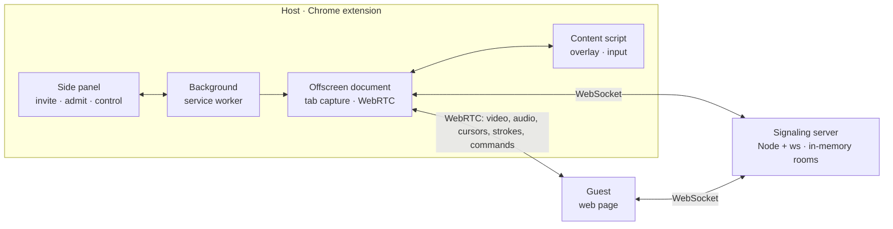

<div align="center">

# Cursor Watchalong

**Share a live Chrome tab with friends who can point, draw, and take the wheel.**

Like screen sharing, except guests can interact with the page instead of only watching it.

[](LICENSE)


[Overview](#overview) · [Features](#features) · [How it works](#how-it-works) · [Getting started](#getting-started) · [Roadmap](#roadmap) · [Design doc](docs/design.md)

</div>

---

> [!NOTE]
> All five milestones are implemented and covered by unit and browser tests. Tab capture itself
> can only be exercised by hand (Chrome requires a real click on the extension), so try it in your
> own Chrome before publishing. See [Testing](#testing).

## Overview

A host shares one tab through the Chrome extension and sends friends an invite link. Guests join
from a regular web page, with **no install and no account**. Everyone sees each other's named
cursors and can draw quick marks over the page that fade after a few seconds.

The main use case is watching videos together. When someone spots a detail in a YouTube video,
they can pause it, circle the detail, and press play again. Everyone sees it happen in the same
shared tab.

**No accounts and no database.** Rooms exist only in the server's memory while a session is
running. Video, audio, cursors and drawings travel directly between participants over WebRTC.

## Features

| | Feature | Details |
| --- | --- | --- |
| 🔗 | **Invite links** | Unguessable room links. The secret lives in the URL fragment, so it never appears in server logs. |
| ✅ | **Host approval** | The host admits or denies each guest before they can see anything. |
| 📺 | **Live tab sharing** | The host's tab video and audio at up to 1080p30, sent peer to peer. |
| 🖱️ | **Shared cursors** | Every participant has a colored, named cursor. |
| ✏️ | **Fading drawings** | Freehand marks that fade about three seconds after you finish drawing. |
| ⏯️ | **Playback control** | Play, pause and seek the page's video, plus familiar shortcuts (Space/K, J/L, arrows, M). |
| 👆 | **Page interaction** | Guests with control can click and scroll in the shared tab. |
| 🛡️ | **Host stays in charge** | Guests start with point and draw only. The host grants control per guest and can end the session at any time. |

Guests can only act on the one tab the host chose to share. They can't reach other tabs, the
address bar, or the rest of the browser.

## How it works



1. The host clicks **Start sharing**. The extension captures the tab and creates a room.
2. The host sends the invite link. A guest opens it, enters a name, and waits for the host to admit them.
3. The signaling server introduces host and guest, then steps out of the way. Media and room
   traffic flow **peer to peer**, using a TURN relay only when a direct connection isn't possible.
4. Guest commands reach the host's extension, which checks the guest's permissions before applying
   them to the shared tab. Cursors and drawings are drawn on an overlay inside that tab, so they
   are part of the stream everyone watches.

Positions are measured relative to the shared tab's viewport, so a circle lands on the same spot
no matter what size window someone watches in. See the [design doc](docs/design.md) for the full
architecture, protocol and trade-offs.

## Tech stack

| Area | Tools |
| --- | --- |
| Extension | [WXT](https://wxt.dev) (Manifest V3), React, offscreen documents, `chrome.tabCapture`, side panel |
| UI | [shadcn/ui](https://ui.shadcn.com) on Radix, Tailwind CSS v4, lucide icons, sonner toasts (shared `packages/ui`) |
| Guest app | React, Vite |
| Server | Node.js, [`ws`](https://github.com/websockets/ws), in-memory rooms |
| Realtime | WebRTC (P2P mesh), DataChannels, Cloudflare TURN |
| Protocol | [zod](https://zod.dev) schemas shared by every package and checked on every message |
| Quality | TypeScript (strict), [Vitest](https://vitest.dev), Playwright, [Biome](https://biomejs.dev) |
| Deploy | Docker, [Fly.io](https://fly.io) |

## Project structure

```text
cursor-watchalong/
├── apps/
│   ├── extension/     # Chrome extension: background, offscreen capture, popup, side panel
│   ├── server/        # Signaling server with in-memory rooms; serves the guest app
│   └── web/           # Guest web app (/r/<roomId>#k=<secret>) + Playwright e2e
├── packages/
│   ├── host-core/     # Host engine: signaling, WebRTC per guest, roster, permissions
│   ├── protocol/      # Message schemas, coordinate math, shared constants
│   └── ui/            # shadcn/ui components and the Watchalong theme
└── docs/
    └── design.md      # Product and technical decisions, milestones
```

## Getting started

### Prerequisites

- [Node.js](https://nodejs.org) 22 or newer
- [pnpm](https://pnpm.io) 10
- Google Chrome or Chromium

### Install

```bash
git clone https://github.com/RealCloudyPanda/Cursor-Watchalong.git
cd Cursor-Watchalong
pnpm install
```

### Run locally

Start each part in its own terminal:

```bash
pnpm dev:server   # signaling server  → http://localhost:8787
```

```bash
pnpm dev:web      # guest web app     → http://localhost:5173
```

```bash
pnpm dev:ext      # opens Chromium with the extension loaded
```

To load the extension in your own Chrome instead, run `pnpm build`, open `chrome://extensions`,
turn on **Developer mode**, click **Load unpacked**, and choose `apps/extension/.output/chrome-mv3`.

### Configuration

The extension reads `WXT_*` variables from a `.env` file at build time (copy `.env.example` to
`apps/extension/.env`). The server reads its variables from the environment, for example
`PORT=9000 pnpm dev:server`.

| Variable | Used by | Default | Purpose |
| --- | --- | --- | --- |
| `PORT` | server | `8787` | HTTP and WebSocket port |
| `WXT_PUBLIC_ORIGIN` | extension | `http://localhost:5173` | Base URL for invite links |
| `WXT_WS_URL` | extension | `ws://localhost:8787/ws` | Signaling WebSocket URL |
| `CF_TURN_KEY_ID`, `CF_TURN_API_TOKEN` | server | *(empty)* | Cloudflare Realtime TURN credentials. Uses public STUN only when empty. |
| `ALLOWED_ORIGINS` | server | *(empty = any)* | Comma-separated origins allowed to open the WebSocket (your site and `chrome-extension://<id>`) |
| `ROOMS_PER_IP_PER_MIN`, `MAX_ROOMS` | server | `10`, `2000` | Abuse limits |

## Scripts

| Command | Description |
| --- | --- |
| `pnpm dev:server` | Run the signaling server with auto-reload |
| `pnpm dev:web` | Run the guest app with hot reload |
| `pnpm dev:ext` | Run the extension in development mode |
| `pnpm build` | Build every package |
| `pnpm test` | Run the unit tests |
| `pnpm --filter @watchalong/web e2e` | Run the Playwright browser tests (real WebRTC between two browsers) |
| `pnpm --filter @watchalong/extension zip` | Package the extension for the Chrome Web Store |
| `node scripts/render-icons.mjs` | Regenerate extension icons from `apps/extension/assets/icon.svg` |
| `pnpm typecheck` | Type-check every package |
| `pnpm lint` | Lint and check formatting |
| `pnpm format` | Fix formatting and safe lint issues |

## Testing

- **Unit tests** (Vitest) cover the protocol, room server, host engine helpers, TURN credentials,
  shortcuts and video selection.
- **Browser tests** (Playwright, installed Chrome) run real WebRTC sessions between a scripted
  host page and guest pages: admission, live video with decoded frames and audible audio,
  deny/kick/leave/end, signaling reconnects, playback control and permissions, cursors, drawing
  and fade timing, clicks, scrolling and iframe forwarding.
- **By hand:** Chrome only allows tab capture after a real click on the extension's icon, so the
  capture path (popup → offscreen → stream) can't be automated. Load the unpacked build, share a
  YouTube tab, and join from another browser or device.

Every milestone was also reviewed by parallel Codex (GPT-6.1 Sol) agents, and their findings were fixed.

## Deployment

The server also serves the built guest app, so one container runs everything.

```bash
fly launch --no-deploy   # first time only
fly deploy --ha=false    # one machine: rooms live in memory
fly scale count 1        # keep it at one if it was ever scaled up
```

Run a **single instance**: rooms live in memory, so a restart or redeploy ends every active session.

```bash
fly secrets set CF_TURN_KEY_ID=... CF_TURN_API_TOKEN=... ALLOWED_ORIGINS=https://cursor-watchalong.fly.dev,chrome-extension://<id>
```

For a store build, put `WXT_PUBLIC_ORIGIN` and `WXT_WS_URL` in `apps/extension/.env.production`,
then run `pnpm --filter @watchalong/extension zip`. Listing copy and permission justifications are in
[docs/store-listing.md](docs/store-listing.md); the privacy policy is served at `/privacy`.

## Roadmap

- [x] **M0 · Foundation**: monorepo, message protocol, room server, host approval, guest join flow
- [x] **M1 · Streaming**: 1080p tab video and audio from host to guests, reconnects
- [x] **M2 · Playback**: play, pause and seek from guests, plus keyboard shortcuts
- [x] **M3 · Cursors and drawing**: named cursors and fading freehand marks
- [x] **M4 · Page control**: clicks and scrolling, per-guest control permissions
- [x] **M5 · Launch prep**: up to four guests, Cloudflare TURN, icons, privacy policy, store listing
- [ ] Publish: deploy to Fly.io, set TURN secrets, submit to the Chrome Web Store
- [ ] Later: Netflix-style sync mode (each person plays their own stream)

## Known limitations

- **Protected video** (Netflix, Disney+, Prime Video and similar) usually appears black in tab
  capture. The extension warns about these sites. A playback-sync mode for them may come later.
- **Some sites ignore simulated input.** Guest clicks are simulated by the extension, and a few
  sites only react to real mouse events. Fullscreen and pop-ups can't be triggered remotely.
- **The host's upload speed limits room size.** The host sends a separate stream to each guest,
  about 4–6 Mbps each at 1080p.
- **Guests see shared marks with a short delay**, because cursors and drawings travel inside the video stream.

## Contributing

Issues and pull requests are welcome. Before opening a pull request, make sure these pass:

```bash
pnpm typecheck && pnpm lint && pnpm test
```

Product or architecture changes should update [docs/design.md](docs/design.md) in the same pull request.

## License

Released under the [MIT License](LICENSE).
